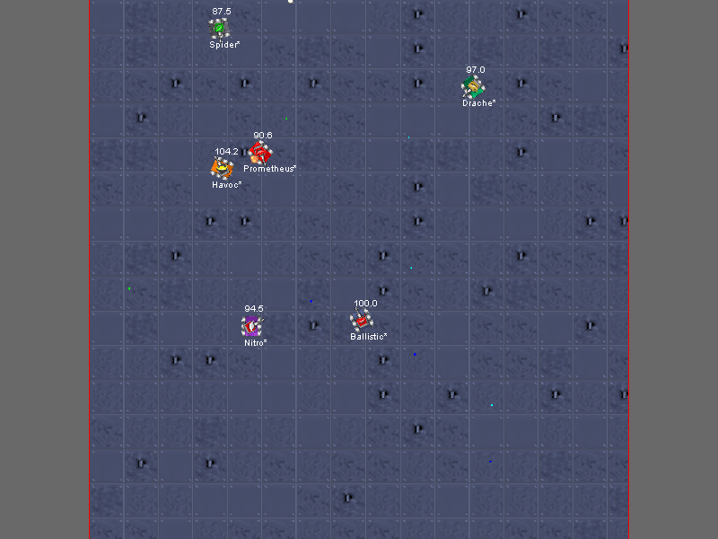
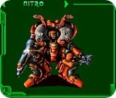
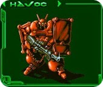
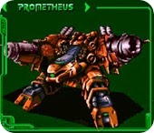
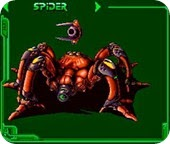
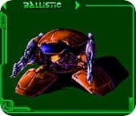
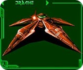
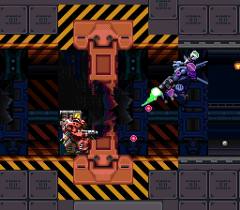
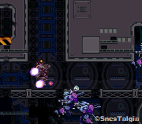
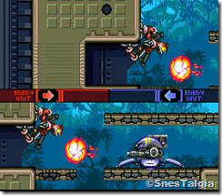

# metal-warriors-robocode

Robôs feitos para o [Robocode](https://github.com/robo-code/robocode), inspirados nos seis mechs do jogo
[Metal Warriors](https://en.wikipedia.org/wiki/Metal_Warriors) (SNES, 1995).

> Status do projeto: em desenvolvimento



*Batalha no Robocode com os seis robôs: Spider, Drache, Prometheus, Havoc, Nitro e Ballistic.*

> **A ideia não é vencer, e sim simular os padrões do jogo nos robôs.** O Metal Warriors é um jogo de plataforma
> visto de lado; o Robocode é uma arena vista de cima. Então o que se traduz é o *estilo* de cada mech (ritmo, alcance,
> tipo de ataque, fraquezas), e não a mecânica de pular, voar ou usar escudos.

## Os robôs

| Robô | Cor | No jogo | No Robocode |
|---|---|---|---|
| <br>[**Nitro**](MetalWarriors/Nitro.java) | roxo | O mech principal, o mais equilibrado: rifle de plasma, sabre de luz, escudo de energia e voo ilimitado. | Orbita o inimigo a ~250 px atirando com mira preditiva (potência 1,5 a 2). Se o inimigo chega a menos de 110 px, investe com o "sabre" (tiro de potência 3). Quando percebe que o inimigo atirou (queda de energia), inverte o sentido da órbita, como o escudo. |
| <br>[**Havoc**](MetalWarriors/Havoc.java) | laranja | Versão mais antiga do Nitro. Tem a metralhadora mais rápida (e de menor dano), corrente com lâmina e é o mais veloz em solo, graças aos jatos nos pés. | Mantém ~150 px de distância e circula o inimigo na maior velocidade possível. Atira rajadas de potência 0,7 com um pouco de dispersão. De perto (menos de 90 px), usa a "corrente" (potência 2,5). |
| <br>[**Prometheus**](MetalWarriors/Prometheus.java) | vermelho | Tanque pesado e lento, sem pulo nem voo. Canhão principal, lança-chamas, minas gravitacionais e escudo de 360°. | Velocidade máxima 4. Canhão de potência 3 de longe (mais de 250 px), potência 2 a média distância e 3 de perto; revida com tiro quando alguém bate nele. A cor escurece conforme a energia cai: vermelho, marrom e preto. |
| <br>[**Spider**](MetalWarriors/Spider.java) | cinza | Robô de reconhecimento de seis pernas: sobe paredes e teto, tem lâminas fortes na cabeça, lança teias e fica invisível, mas parado. | Anda grudado nas paredes, contornando a arena. De tempos em tempos fica "camuflado" (parado e sem atirar em inimigo longe). Se alguém chega a menos de 250 px, dá um tiro de emboscada (potência 3). De perto usa as "lâminas". |
| <br>[**Ballistic**](MetalWarriors/Ballistic.java) | azul-aço | Muito rápido, mas não pode andar e atirar ao mesmo tempo. Canhão de plasma carregável (como o do Megaman) e investida em esfera ("spin dash"). | Máquina de estados: **rola** a toda velocidade em direção ao inimigo (sem atirar), depois **para e carrega** o plasma. Quanto mais carga, mais forte o tiro. Com pouca energia (menos de 30), foge, já que no jogo é o mais voltado para fuga. |
| <br>[**Drache**](MetalWarriors/Drache.java) | verde e dourado | A unidade aérea: flutua o tempo todo e atira para várias direções. Tem a melhor defesa (campo de força com as asas) e um mergulho devastador. | Hit-and-run: voa direto para o inimigo, dá o tiro de mergulho (potência 3) a menos de 170 px e foge para longe antes de voltar. O campo de força não existe no Robocode, então ele compensa não ficando parado perto do inimigo. |

**Como o jogo mostra a vida:** o Metal Warriors não tem barra de vida; o mech vai escurecendo conforme leva dano. Os
robôs reproduzem isso: quanto menos energia, mais escuro o corpo.

## O cenário do jogo

O Metal Warriors se passa em fases de plataforma vistas de lado, com túneis, elevadores e áreas que só dá para
acessar saindo do robô. No multiplayer a tela é dividida ao meio.

<p>
  
  
  
</p>

*Imagens do jogo (SNES): duas fases do modo história e o modo multiplayer em tela dividida.*

## Como usar

1. Instale o [Robocode](https://robocode.sourceforge.io/) (testado com a versão 1.12.0 e Java 21).
2. Abra o Robocode e vá em **Options → Preferences → Development Options → Add**, e escolha a pasta **que contém**
   `MetalWarriors/` (a raiz deste repositório), não a pasta `MetalWarriors` em si.
3. Em **Battle → New**, o pacote **MetalWarriors** aparece na lista. Selecione os robôs, clique em **Add** e depois
   em **Start Battle**.

Os arquivos `.class` já estão no repositório. Para recompilar depois de editar algum robô (na raiz do projeto, com o
`robocode.jar` da instalação do Robocode):

```
javac -encoding UTF-8 -cp libs/robocode.jar -d . MetalWarriors/*.java
```

## Referências

- Gameplay do Prometheus: https://www.youtube.com/watch?v=rIsv8674g78
- Análise do jogo (descrição dos seis mechs): [SnesTalgia](https://snestalgia.blogspot.com/2014/04/analise-metal-warriors.html)
- [Metal Warriors na Wikipedia](https://en.wikipedia.org/wiki/Metal_Warriors)
- [API do Robocode](https://robocode.sourceforge.io/docs/robocode/)

## Créditos das imagens

As imagens dos mechs e do cenário do jogo vêm da análise do blog [SnesTalgia](https://snestalgia.blogspot.com/2014/04/analise-metal-warriors.html) (arte de Soterio Salles). O Metal Warriors é de Konami / LucasArts; as imagens são usadas aqui apenas para ilustrar este projeto de fãs, sem fins comerciais.
